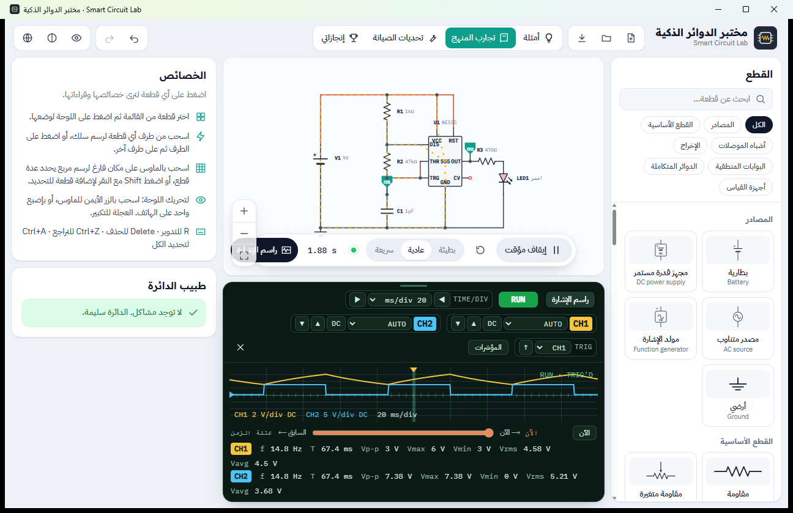

<p align="center">
  
</p>

<h1 align="center">Smart Circuit Lab · مختبر الدوائر الذكية</h1>

<p align="center">
  A free electronics lab simulator for vocational and secondary school students, in Arabic and English.<br>
  Works fully offline on Windows and Android.
</p>

<p align="center">
  <a href="https://github.com/AliNajmTheGhost/smart-circuit-lab/releases/latest"><b>⬇ Download (Windows EXE · Android APK)</b></a> ·
  <a href="#install">Install</a> ·
  <a href="#for-schools-and-universities">For schools</a> ·
  <a href="README.ar.md">العربية</a>
</p>

---

Smart Circuit Lab lets students build electrical and electronic circuits on screen, switch them on, and measure them with virtual instruments, the same way they would on a lab bench. It was built for the communications department of Iraqi vocational schools as an easier, Arabic-first replacement for Electronics Workbench, and it follows the experiments of their practical-training textbooks.

Made by **Eng. Ali Najm (المهندس علي نجم)**.



## Features

- **Real simulation, not animation.** A circuit simulation engine written in Rust computes every voltage and current as the circuit runs. Parts burn out when overloaded, capacitors charge, oscillators oscillate.
- **More than 55 parts:** batteries, power supply, AC source, function generator, resistors, potentiometer, capacitors, coils, transformer, diodes, Zener, LEDs, transistors (NPN/PNP, MOSFET), SCR, triac, op-amp, 555 timer, logic gates, flip-flops, counters, 7-segment displays, A/D and D/A converters, transmission line, speaker, buzzer, infrared link and more.
- **Instruments like the real ones:** multimeter (AVO), voltmeter, ammeter, a two-channel oscilloscope with automatic measurements, a Bode plotter, and a curve tracer for diodes and transistors.
- **Curriculum experiments:** step-by-step experiments from the grade 1–3 practical-training books, checked automatically, plus 35 ready-made example circuits.
- **Circuit doctor:** explains mistakes in plain language (an unconnected pin, a shorted source, a burnt part and why it burnt).
- **Repair challenges:** circuits with a hidden faulty part. Students measure, find the fault and replace it, and earn up to three stars.
- **Sound:** speakers play the frequency the circuit really produces, buzzers beep, switches click.
- **Achievements:** badges students earn as they experiment, saved on their own device.
- **Made for phones too:** touch-first editing on Android, with a bottom sheet for part values and a one-tap move tool.
- **Offline and private:** no internet, accounts or data collection. Everything stays on the device.

## Languages

Arabic (right-to-left) and English are supported today, and the language can be switched at any time from the toolbar. Other languages can be added on request: see [For schools and universities](#for-schools-and-universities).

## Install

Download the files from the [latest release](https://github.com/AliNajmTheGhost/smart-circuit-lab/releases/latest).

### Windows 10 and 11

1. Download `SmartCircuitLab-<version>-windows-offline-setup.exe` (about 210 MB). It carries everything it needs, so it installs on computers with **no internet connection**: copy it with a USB stick to every lab computer.
2. Run it. No administrator rights are needed.
3. Windows may show *"Windows protected your PC"* because the installer is not signed with a paid certificate. Click **More info**, then **Run anyway**.
4. Open **Smart Circuit Lab** from the Start menu or the desktop. Circuit files (`.sclab`) open with a double-click.

Windows 7 and 8 are not supported.

### Android 7 and later

1. Download `SmartCircuitLab-<version>-android.apk` (about 13 MB) on the phone, or send it to the phone over Telegram or a cable.
2. Open the file. If Android asks, allow installing apps from this source.
3. Open **مختبر الدوائر الذكية** from the app list.

Updates install over the previous version and keep your circuits and badges.

## For schools and universities

The program is free for schools, universities, teachers and students. If your institution needs **a custom version** (your own curriculum experiments, your logo, another language, special parts or instruments, exam features, or changes that suit your lab), I am happy to work with you.

**Contact:** Eng. Ali Najm, [alinajm20012011@gmail.com](mailto:alinajm20012011@gmail.com)

Bug reports and suggestions are welcome by email or as [GitHub issues](https://github.com/AliNajmTheGhost/smart-circuit-lab/issues).

## License

Smart Circuit Lab is free for **non-commercial use** under the [PolyForm Noncommercial License 1.0.0](LICENSE). Schools, universities, teachers, students and other non-profit or government institutions may use it, copy it, share it and modify it at no cost.

- Keep the copyright notice with every copy: `Required Notice: Copyright (c) 2026 Ali Najm`.
- Selling it or using it for commercial purposes is not allowed. For commercial use, ask for a separate licence by email.

## Building from source

You need [Node.js](https://nodejs.org) 20 or later, [Rust](https://rustup.rs) with the WebAssembly target, and `wasm-bindgen-cli`:

```bash
rustup target add wasm32-unknown-unknown
cargo install wasm-bindgen-cli --version 0.2.129 --locked
npm install
npm run dev
```

| Command | What it does |
|---|---|
| `npm run dev` | Run the interface in the browser while developing |
| `npm test` | Interface tests on the Rust engine, then the engine's own tests |
| `npm run build:desktop:offline` | Windows installer that carries WebView2 (works without internet) |
| `npm run build:android` | Signed Android APK (JDK 17, Android SDK and NDK needed; a signing key outside the repository) |

The engine lives in `crates/core` (Rust, one file per family of parts), the interface in `src/` (TypeScript), and the Windows/Android shell in `src-tauri/` ([Tauri 2](https://tauri.app)). Developer notes are in the [Arabic README](README.ar.md).
